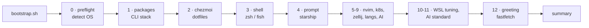

<div align="center">

# Umbra · WSL environment

**One-command development environment for WSL Arch and WSL Ubuntu.** Part of [Umbra](../../README.md); migrated from lux-dotfiles.

[](docs/os/arch.md)
[](docs/os/ubuntu.md)
[](docs/sections/03-shell.md)
[](docs/THEMES.md)

[Install](#install) · [What you get](#what-you-get) · [Themes](docs/THEMES.md) · [Tools](docs/TOOLS.md) · [Cheatsheet](docs/CHEATSHEET.md) · [Docs](docs/README.md)

</div>

---

## Install

**WSL (Arch / Ubuntu)**, from a clone of the umbra repo:

```bash
git clone https://github.com/Robertcl795/umbra.git ~/dev/umbra
bash ~/dev/umbra/env/wsl/bootstrap.sh
```

The one-line `curl … | bash` install below needs the umbra repo to be public, which happens in Phase 5 (ADR 0001). Until then, install from a clone.

**Native Windows** is not part of Umbra v0.2. The PowerShell installer stays in lux-dotfiles; see [docs/os/windows.md](docs/os/windows.md).

<details>
<summary><b>Other ways to install</b> — from a branch, from a clone, non-interactive</summary>

<br>

```bash
# From a feature branch
BRANCH=my-branch
curl -fsSL "https://raw.githubusercontent.com/Robertcl795/umbra/$BRANCH/env/wsl/bootstrap.sh" \
  | UM_BRANCH=$BRANCH bash

# One line, once the repo is public
curl -fsSL https://raw.githubusercontent.com/Robertcl795/umbra/main/env/wsl/bootstrap.sh | bash

# Non-interactive, everything chosen up front
UM_SHELL=zsh UM_THEME=cyber bash bootstrap.sh --yes --profile personal

# Only some phases, or all but some
bash bootstrap.sh --yes --components packages,link,shell,prompt
bash bootstrap.sh --yes --skip k8s,ai-cli
```

Phase names: `packages shell prompt nvim k8s zellij lang ai-cli wsl ai-standard fastfetch`. The dotfiles themselves are always deployed by chezmoi (ADR 0006).

**Fresh Arch WSL** starts as `root` with no user. Run the same command: it
updates the system, enables sudo for `wheel`, creates your user, sets it as
the WSL default, and offers to `wsl --shutdown`. Reopen Arch and the install
**resumes automatically** from a one-shot `~/.bashrc` hook.
Details: [docs/os/arch.md](docs/os/arch.md).

</details>

> [!TIP]
> Keep the repo and your projects under `~/`, never `/mnt/c/...` — cross-OS
> I/O is 10-20× slower. The bootstrap moves off `/mnt` automatically, and the
> shell warns (and auto-`cd`s home) when a session starts there.

## What you get



| Area | What's installed | Docs |
| --- | --- | --- |
| **Shell** | zsh (default) with vi-mode, autosuggestions, fast-syntax-highlighting, history-substring-search — or fish with fisher + fzf.fish, installed only when fish is the chosen shell (ADR 0004) | [03-shell](docs/sections/03-shell.md) |
| **Prompt** | [Starship](https://starship.rs), five themes | [THEMES](docs/THEMES.md) |
| **CLI stack** | bat · eza · fzf · zoxide · ripgrep · fd · lazygit · lazydocker · glow · duf · yazi · sshs · lnav · just · zellij | [TOOLS](docs/TOOLS.md) |
| **Greeting** | fastfetch on every new tab | [12-fastfetch](docs/sections/12-fastfetch.md) |
| **Editor** | Neovim + lazy.nvim | [05-nvim](docs/sections/05-nvim.md) |
| **Languages** | rustup · fnm (Node) · uv (Python) · kubectl/helm/k3d | [08-lang-toolchains](docs/sections/08-lang-toolchains.md) |
| **AI** | Claude Code · opencode · gh copilot, plus the [AI Development Standard](../../toolkit/ai-standard/README.md) (personal profile only) | [09](docs/sections/09-ai-tooling.md) · [11](docs/sections/11-ai-standard.md) |
| **WSL tuning** | `.wslconfig` networking, systemd, NTFS performance guards | [10-wsl](docs/sections/10-wsl.md) |

The aliases you'll use every day — full list in the
[cheatsheet](docs/CHEATSHEET.md):

| Git | | Files | |
| --- | --- | --- | --- |
| `gst` `git status` | `gc` `commit -v` | `ls` eza with icons | `cat` bat |
| `gco` `checkout` | `gcob` `checkout -b` | `z <dir>` zoxide jump | `y` yazi |
| `gsw` `switch` | `gswc` `switch -c` | `lg` lazygit | `ld` lazydocker |
| `gb` `branch` | `gbD` `branch -D` | `ff` fastfetch | `vim` nvim |

## Configure

Everything is interactive on a terminal; every prompt has an env-var override. Without a terminal, or with `--yes`, every prompt takes its default.

| Variable | Values | Default |
| --- | --- | --- |
| `UM_SHELL` | `zsh` · `fish` | `zsh` |
| `UM_THEME` | `default` · `tron` · `cyber` · `eva01` · `minimal` | `default` |
| `UM_MODE` (`--profile`) | `personal` · `work` — work skips the AI standard and opencode | `personal` |
| `UM_COMPONENTS` (`--components`) · `UM_SKIP` (`--skip`) | comma-separated phase names | all phases |
| `UM_ENABLE_K8S` | `0` · `1` | prompt on a terminal; `1` otherwise |
| `UM_NO_FASTFETCH` | `1` disables the shell greeting | unset |
| `UM_NO_AUTOCD` | `1` keeps shells in `/mnt/*` | unset |
| `UM_ENABLE_WSLCONFIG` | `0` · `1` — write `/etc/wsl.conf` and `.wslconfig` on the Windows host (no prompt) | `1`; in the work profile `.wslconfig` is left alone unless set to `1` |
| `UM_WSL_NETWORKING` | `nat` · `mirrored` | `nat` |
| `UM_NONINTERACTIVE` (`--yes`) | `1` accepts every default | unset |
| `UM_IS_WSL` | `1` · `0` — skip WSL detection (container tests) | detect |
| `UM_REPO_DIR` | where a fresh clone goes | `~/dev/umbra` |
| `UM_VERBOSE` | `1` traces every command | unset |
| `UM_BRANCH` | branch to bootstrap from | `main` |

After changing WSL networking, run `wsl --shutdown` from PowerShell and
reopen your terminal.

## Day to day

From `env/wsl/` in the umbra checkout:

```bash
bash bootstrap.sh --yes                               # re-run the full bootstrap (chezmoi re-runs only what changed)
bash tests/99_smoke.sh                                # run every checkpoint
UM_THEME=tron chezmoi init --apply                    # switch prompt theme, no re-bootstrap
chezmoi diff && chezmoi apply                         # after editing a dotfile in env/
bash install/fastfetch.sh --run                       # reinstall/relink the greeting
bash ../../toolkit/ai-standard/scaffold.sh ~/p        # drop the AI standard into a repo
```

## Layout of `env/wsl/`

| Path | Contents |
| --- | --- |
| `bootstrap.sh` · `install.sh` | Entry points (`install.sh` runs the phases of an existing checkout) |
| `install/` | Bootstrap phases, one script per phase; chezmoi runs them from `env/.chezmoiscripts/`. `run.sh` runs them without chezmoi (fallback, no dotfiles) |
| `config/` | `git/` and `alacritty/`, kept but not deployed. The deployed dotfiles live in [`env/`](..) under chezmoi names (`dot_zshrc.tmpl`, `dot_config/…`, ADR 0006) |
| `env/dot_config/fish/` | Shell entry points (`zshrc`, fish `config.fish` + `conf.d/`) |
| `env/.chezmoitemplates/starship` | Starship themes (Windows Terminal schemes moved to `themes/terminals/windows-terminal/` at the repo root) |
| `env/dot_config/nvim/` | Neovim configuration |
| `tests/` | One checkpoint script per phase |
| `docs/` | [Documentation](docs/README.md) |

The AI Development Standard lives in [`toolkit/ai-standard/`](../../toolkit/ai-standard/README.md). The Git config in `config/git/` sets no user name or email; set them yourself.

## License

All rights reserved until Phase 5; the license decision is in the [ROADMAP](../../ROADMAP.md).
